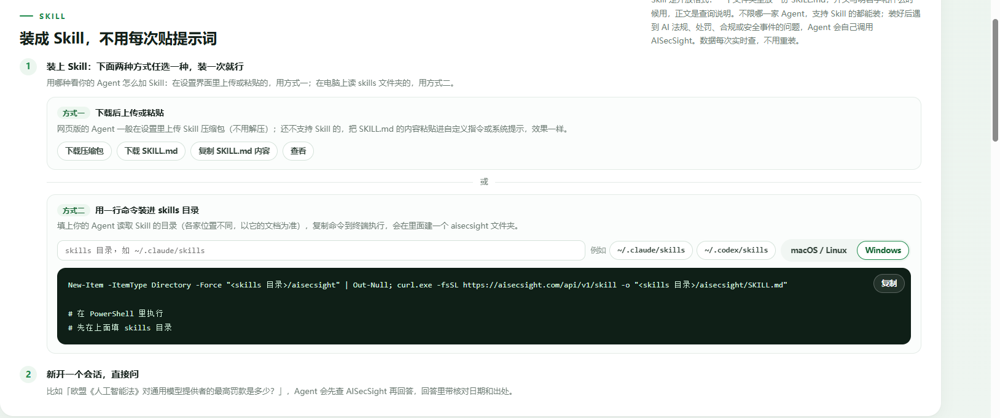

# AISecSight Skill · 全球 AI 安全法规查询

**简体中文** · [English](README.en.md)

[](LICENSE)
[](aisecsight/SKILL.md)
[](https://aisecsight.com/api/v1)
[](https://github.com/SecurityGuardian-pro/aisecsight-skill/stargazers)

**装一次 Skill，之后问 AI 法规就自动查、自动给条款和出处，不用每次贴提示词。**

<table>
<tr>
<td width="62%" valign="top">

把 [AISecSight](https://aisecsight.com) 整理的全球 AI 安全法规库接进你的 Agent。装好之后，你在 Claude Code、Codex、Cursor 里随口问一句「欧盟 AI 法对通用模型提供者的罚款上限是多少」，Agent 会自己调接口取回条款原文再回答，并带上核对日期和官方链接。

- 85 部法规与标准，覆盖欧盟、中国、美国、亚太与国际组织
- 处罚条款精确到条（Art. 99(3)）、原文引文和生效日期
- 匿名只读接口，不需要 API Key，不收集任何数据

</td>
<td width="38%" valign="top" align="center">


**微信公众号：数字安全守护者**

扫码关注，法规更新与 AI 安全动态不错过

</td>
</tr>
</table>

---

## 为什么需要它

大模型对 AI 法规的记忆有几个固定毛病，而且都是硬伤：

| 问题 | 典型表现 | 装了 Skill 之后 |
|---|---|---|
| **日期会漂** | 把「2026-08-02 起适用」的条款说成已经全面生效 | 按接口返回的 `stage` / `effective` / `reviewed` 回答 |
| **罚款金额记错** | 欧盟 AI 法只记得「3500 万欧元」，漏掉「或全球营业额 7%，取高者」 | 金额与条款（`tiers[].article`）、原文引文一起给 |
| **修订跟不上** | 不知道欧盟已通过 Digital Omnibus（Reg (EU) 2026/1744）修正 | 法规 `summary` 里逐条写明修正与新的适用日期 |
| **只给结论不给出处** | 无法核对，会议上不敢引用 | 每条都带官方源链接与信源名称 |
| **新旧条文混淆** | 把拟议稿当现行法 | `stage` 区分已生效 / 已签署 / 立法中 / 已搁置 |

---

## 它能回答什么

| 你想知道 | 直接问 |
|---|---|
| 某部法规的内容、状态、生效日期、义务、处罚 | 「欧盟《人工智能法》对高风险系统的透明度义务有哪些？」 |
| 不同法域的监管差异 | 「中国和欧盟对深度合成标识的要求差在哪？」 |
| 某类产品要遵守什么 | 「在中国做面向公众的生成式 AI 助手，要走哪些合规步骤？」 |
| 某个标准的适用 | 「ISO/IEC 42001 和 NIST AI RMF 该怎么配合用？GB/T 45081 是哪个的等同采用？」 |
| 罚款到底多少、怎么算 | 「各国 AI 法里最高的行政处罚分别是多少？折人民币多少？」 |
| 最近的立法与监管动态 | 「这周 AI 治理有什么新动作？」 |
| 真实发生的 AI 安全事件 | 「2023 年以来有哪些智能体失控的真实案例？」 |

---

## 快速安装

### 方式一：装成 Skill（推荐，一次装好长期生效）

Skill 就是一个带 YAML 头的 `SKILL.md` 文件夹。装到你的 Agent 读取的 skills 目录里，它就会在遇到相关问题时自动调用。

**① 一键命令（macOS / Linux）**

```bash
SKILLS_DIR="$HOME/.claude/skills"   # 换成你的 Agent 的目录
mkdir -p "$SKILLS_DIR/aisecsight" && \
curl -fsSL https://aisecsight.com/api/v1/skill -o "$SKILLS_DIR/aisecsight/SKILL.md"
```

**② 一键命令（Windows PowerShell）**

```powershell
$dir = "$HOME\.claude\skills"
New-Item -ItemType Directory -Force "$dir\aisecsight" | Out-Null
curl.exe -fsSL https://aisecsight.com/api/v1/skill -o "$dir\aisecsight\SKILL.md"
```

**③ 用本仓库的安装脚本**（会顺手做一次接口连通性自检）

```bash
git clone https://github.com/SecurityGuardian-pro/aisecsight-skill.git
cd aisecsight-skill
./scripts/install.sh          # macOS / Linux
# .\scripts\install.ps1       # Windows PowerShell
```

**④ 手动**：下载 [`aisecsight/SKILL.md`](aisecsight/SKILL.md)，放进 skills 目录下的 `aisecsight/` 文件夹即可。

各 Agent 的 skills 目录：

| Agent | 目录 |
|---|---|
| Claude Code | `~/.claude/skills/` |
| Codex CLI | `~/.codex/skills/` |
| Cursor | `~/.cursor/skills/` |
| Gemini CLI | `~/.gemini/skills/` |
| WorkBuddy | `~/.workbuddy/skills/` |
| 其他 | 见该 Agent 文档中「skill」目录配置项 |

装完**新开一个会话**再问，Agent 才会加载到新 Skill。

### 方式二：不装 Skill，直接调接口

Skill 本质上只是给 Agent 的一份说明书，接口本身谁都能直接请求：

```bash
# 查关键词
curl -s "https://aisecsight.com/api/v1/laws?q=深度伪造" | jq '.laws[] | {id, name, status}'

# 查某部法规的罚则
curl -s "https://aisecsight.com/api/v1/laws/euact" | jq '.law.penalty.tiers[] | {article, fine}'

# 查最近的治理动态
curl -s "https://aisecsight.com/api/v1/news?type=governance&limit=5" | jq '.items[] | {date, title}'
```

### 方式三：什么都不装

把下面这句直接发给任意 Agent，它就能自己接上：

> 请 GET `https://aisecsight.com/api/v1/skill` 读取这份说明书，之后我所有关于 AI 法规的问题都按它来查、来答。

> 官网也提供图形化安装入口（可选安装方式、`SKILL.md` 内容预览、一键复制命令）：
>
> 

---

## 使用示例

**问：欧盟《人工智能法》里，违反禁止性 AI 实践最高罚多少？**

> 答（依据接口返回，2026-10-21 核对）：违反第 5 条禁止性实践的行政处罚**最高 3500 万欧元，或企业上一财年全球年营业额的 7%，取较高者**（中小企业取较低者）——Art. 99(3)。
>
> - 适用时间：第 5 条禁令自 **2025-02-02** 起适用；第 XII 章罚则自 **2025-08-02** 起适用（Art. 113(a)(b)）。经 Reg (EU) 2026/1744 新增的第 5(1)(ba)(bb) 项（未经同意的私密深度伪造、儿童性虐待材料）自 **2026-12-02** 起适用，同样落入本档。
> - 第二档：违反提供者/部署者义务或第 50 条透明度义务，最高 1500 万欧元或全球营业额 3%，取高者。
> - 折算参考：按中国外汇交易中心 2026-09-30 中间价 1 EUR = 7.6215 CNY，3500 万欧元约合 2.67 亿元人民币。
> - 原文：`eur-lex.europa.eu/legal-content/EN/TXT/HTML/?uri=OJ:L_202401689`
> - 出处：[aisecsight.com/law/euact](https://aisecsight.com/law/euact)
>
> 仅供研究与合规参考，不构成法律意见；具体以官方原文和专业法律意见为准。

**问：中国对生成式 AI 服务的标识有哪些强制要求？**

> 答：会同时命中《生成式人工智能服务管理暂行办法》《人工智能生成合成内容标识办法》与强制性国标 GB 45438-2025，并逐条给出显式标识、隐式标识（元数据水印）的适用范围与施行日期，附条款出处。
> 出处：[aisecsight.com/api/v1/qa?q=标识](https://aisecsight.com/api/v1/qa?q=标识)

更多示例见 [`examples/prompts.md`](examples/prompts.md)。

---

## 数据覆盖

| 维度 | 情况 |
|---|---|
| 法规库 | **85 部**（欧盟 10 · 中国 25 · 美国 26 · 亚太 / 国际 / 其他） |
| 类型 | 法律 · 法规与规章 · 政策与行政令 · 标准 · 框架与指南 · 国际文件 |
| 状态 | 已生效 `inforce` · 已签署 `signed` · 立法中 `pending` · 已失效 `lapsed` |
| 核对日期 | 法规状态整体核对至 **2026-10-13**；单部以该条 `reviewed` 为准（更晚者优先） |
| 安全事件 | 2023 年以来 **29 起**重大事件，每条附一手信源 |
| 动态 | 约**每小时**更新；带机器翻译的条目会标 `machineTranslated`，涉及措辞以原文为准 |
| 每周要点 | 每周一生成 |
| 限制 | 单个 IP 每分钟 60 次，超出返回 `429`，按 `Retry-After` 等待，请勿并发重试 |

---

## 接口一览

全部匿名只读、GET 请求、返回 JSON（UTF-8），无需 API Key。

| 想知道 | 请求 |
|---|---|
| 关键词 / 法域 / 类型 / 状态检索 | `/api/v1/laws?q=…&region=eu&kind=标准&stage=inforce` |
| 单部法规详情（要点、义务、罚则、近 90 天报道） | `/api/v1/laws/{id}` |
| 法规之间的关系（上下位 / 冲突 / 影响 / 同源） | `/api/v1/relations?law={id}` |
| 各法规最高处罚与外币折算 | `/api/v1/penalties` |
| 已整理的合规问答（带条款出处） | `/api/v1/qa?q=标识` |
| 最重要的 10 部法规与标准 | `/api/v1/top10` |
| 重大 AI 安全事件 | `/api/v1/incidents?cat=attack` |
| 治理动态 | `/api/v1/news?type=governance&limit=10` |
| 大模型安全事件与研究 | `/api/v1/news?type=safety` |
| 智能体安全 | `/api/v1/news?type=agent` |
| 漏洞与安全事件 | `/api/v1/news?type=vuln` |
| 白皮书 / 报告 / 技术规范 | `/api/v1/news?type=whitepaper` |
| 上一周要点 | `/api/v1/weekly/latest` |
| 接口索引 | `/api/v1` |

参数说明：`q` 关键词（多个用空格分隔，需全部命中，中英文皆可）；`region` 取 `intl` / `eu` / `cn` / `us` / `apac` / `other`；`kind` 取 `法律` / `法规与规章` / `政策与行政令` / `标准` / `框架与指南` / `国际文件`；`stage` 取 `inforce` / `signed` / `pending` / `lapsed`；`limit` ≤ 100。

响应带 `ETag`，重复请求带 `If-None-Match` 可拿 `304`，省流量也省时间。

---

## 它是怎么保证不瞎编的

SKILL.md 里对 Agent 有几条硬约束，这也是这个 Skill 和「随手问模型」的区别：

1. **先查再答** —— 状态、生效日期、罚款金额一律以接口返回为准，不允许凭记忆补。
2. **必注时间** —— 给 `reviewed` 核对日期或动态的 `date` 发布日期。
3. **必给出处** —— 法规给 `links.page`，动态给 `source` 与 `url`。
4. **金额看条款** —— 以 `tiers` 里的条款、`quote` 原文引文为准；外币按 `penalty.fx` 折算并注明汇率日期。
5. **id 不许猜** —— 只从接口返回里取；查不到就如实说没收录。
6. **结尾免责** —— 仅供研究与合规参考，不构成法律意见。

---

## 项目结构

```
aisecsight-skill/
├── aisecsight/
│   └── SKILL.md            # Skill 本体（装进 skills 目录的就是它）
├── examples/
│   └── prompts.md          # 提问示例，含期望回答要点
├── scripts/
│   ├── install.sh          # macOS / Linux 安装
│   ├── install.ps1         # Windows 安装
│   └── verify.py           # 接口连通性与字段自检
├── assets/
│   ├── wechat-qrcode.png   # 公众号二维码
│   ├── wechat-card.png     # 公众号关注卡
│   ├── social-preview.png  # 仓库社交预览图
│   └── logo.png
├── CHANGELOG.md
└── LICENSE
```

## 自检

装完想确认能不能用：

```bash
python scripts/verify.py
```

会依次检查接口索引、法规检索、法规详情罚则、合规问答、动态、每周要点，打印每项的 HTTP 状态与关键字段是否齐全。

---

## 常见问题

**Q：需要 API Key 吗？要付费吗？**
不需要 Key，也不需要注册。接口匿名只读，公开数据。

**Q：会被限流吗？**
单 IP 每分钟 60 次。Agent 正常问答远用不到这个量；触发 `429` 就按 `Retry-After` 等，不要并发重试。

**Q：装了没反应？**
确认三点：目录名是 `aisecsight/`、文件是 `SKILL.md`（大写）、YAML 头完整；然后**新开会话**。部分 Agent 需要重启。

**Q：数据准不准，能不能直接拿去合规？**
法规状态经人工核对并标注日期，每条都链到官方原文。但它是研究工具，**不构成法律意见**，正式结论请以官方原文和专业法律意见为准。

**Q：我提需求 / 发现错漏怎么办？**
开 [Issue](https://github.com/SecurityGuardian-pro/aisecsight-skill/issues)，或到公众号后台留言。

---

## 关注公众号

<table>
<tr>
<td width="58%" valign="top">

**数字安全守护者** —— 每天追踪官方、机构与媒体信源，筛掉重复和噪音，把新规、官方原文和真正值得看的几条留下来；法规状态定期对照原文人工复核。

希望这个小站，能帮做 AI 合规、法务和安全的同行，少花点时间找信息。

内容有误或想补充法规、信源，欢迎在公众号后台留言。

</td>
<td width="42%" align="center">


</td>
</tr>
</table>

---

## 免责声明

本项目与 [AISecSight](https://aisecsight.com) 提供的内容仅供研究与合规参考，不构成法律意见；具体以官方原文和专业法律意见为准。引用请注明 AISecSight 及原始来源。动态类内容版权归各原始来源所有，本项目只提供标题、摘要与原文链接。

## License

[MIT](LICENSE) © 2026 AISecSight
